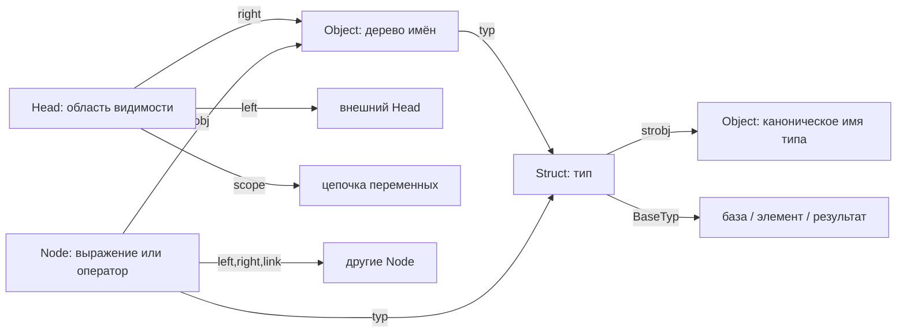

# DevCPT: таблица символов, граф типов и совместимость интерфейсов

Исходник: [CPT.cp](../../Mod/CPT.cp). Контекст: [архитектура компилятора](Compiler-Architecture.md).
Основа алгоритмов: Crelier, *Separate Compilation and Module Extension*, гл. 2, 4 и прежде всего 6; [путеводитель по книге](Compiler-Crelier.md).
Документ описывает текущий исходник bbcb2, включая отличия от OP2 1994 года.

## 1. Место в компиляторе

DevCPT выполняет четыре связанные задачи:

1. Определяет общие записи `Object`, `Struct`, `Const`, `Node`.
2. Управляет областями видимости, поиском имён и предопределёнными объектами.
3. Читает и пишет граф интерфейса модуля в символьных файлах `.osf`.
4. Вычисляет отпечатки объектов и типов, сравнивает версии интерфейса.

Парсер [DevCPP](CPP.md) и семантический построитель [DevCPB](CPB.md) наполняют эти структуры. [DevCPV486](CPV486.md) добавляет размеры, смещения, номера методов и генерирует код. [DevCPE](CPE.md) записывает отпечатки и фактические зависимости в `.ocf`. DevCPT импортирует только DevCPM и Utf: зависимости от генератора кода здесь нет.

Не путать: `Object` означает объявление языка, а не экземпляр RECORD исполняемой программы. `Struct` описывает тип, а не только RECORD. `Node` описывает выражение/оператор. `Const` используется также как контейнер числовых атрибутов.

## 2. Какие графы находятся в памяти

Одни и те же `Object` могут одновременно принадлежать дереву поиска и линейному списку. Копирование записи с указателями не копирует весь граф; изменение разделяемого `Struct` видно всем ссылающимся объектам.

### Object / ObjDesc

| Поле | Значение и где смотреть |
|---|---|
| `left`, `right` | Для обычного объекта — ветви дерева поиска имён. Для `Head`: `left` — внешняя область, `right` — корень её собственного дерева |
| `link` | Параметр/переменная/поле: следующий в цепочке. Процедура: первый формальный параметр. `Head`: владелец области |
| `scope` | Процедура: её `Head`. Импортированный `Mod`: общий `Head` из `GlbMod`. Сам `Head`: первый объект цепочки переменных |
| `name` | Строка SHORTCHAR; отсутствие имени представлено общей строкой `null`, а не `NIL` после `NewObj` |
| `mode` | Род объявления; таблица ниже |
| `mnolev` | Для локальных объявлений лексический уровень; отрицательное значение означает номер импортированного модуля `-mnolev` |
| `vis` | 0 internal, 1 external, 2 externalR; у ссылочных параметров 3 inPar и 4 outPar |
| `typ`, `ptyp` | Текущий тип и исходный тип при временном уточнении в WITH; восстановлением занимается `DevCPP.StatSeq` |
| `conval` | Значение константы, размеры/флаги процедуры или её встроенный код |
| `adr` | Смещение переменной/поля, адрес процедуры; до распределения памяти некоторые объекты хранят здесь позицию исходника |
| `num` | В частности, номер метода в таблице методов |
| `leaf` | Для процедуры отсутствие вложенных вызовов; для переменной возможность регистрового размещения. Смысл зависит от `mode` и фазы |
| `used` | Использование импортированного имени; `FindImport` выставляет TRUE, локальный `Find` этого не делает |
| `fpdone`, `fprint` | Кэш вычисленного отпечатка объекта |
| `history` | Результат сравнения интерфейсов; не история версий на диске |
| `nlink` | Дополнительная цепочка: порядок объявления методов, список имён/объектов библиотеки в других фазах |
| `links` | Цепочки мест для исправления адресов в генерируемом коде/данных; элементы `LinkDesc` |
| `library`, `entry`, `modifiers`, `sysflag` | Дополнительные сведения внешнего интерфейса; интерпретировать по потребителю и виду объекта |
| `linkadr` | В исходнике помечен как используемый ofront; не подменяет `num` текущего x86 backend |

Режимы: `Var=1`, `VarPar=2`, `Con=3`, `Fld=4`, `Typ=5`, `LProc=6`, `XProc=7`, `SProc=8`, `CProc=9`, `IProc=10`, `Mod=11`, `Head=12`, `TProc=13`, `Attr=20`.
`XProc` — экспортируемая процедура, `SProc` — встроенная, `CProc` — code procedure, `IProc` — interrupt procedure, `TProc` — метод. Списки констант повторены в нескольких CP-модулях и образуют внутренний числовой протокол.

Для методов отдельная тонкость: `rec.strobj.link` может указывать на первый метод в порядке объявления, а следующие идут через `nlink` (`DevCPP` и `DevCPV486.EnumTProcs`). `rec.link` при этом служит корнем дерева полей/методов. Нельзя заменить один обход другим.

### Struct / StrDesc

`form` задаёт основной вид: Pointer=13, ProcTyp=14, Comp=15, а также скалярные формы. Если `form=Comp`, поле `comp` различает Array=2, DynArr=3, Record=4; Basic=1 используется для остальных форм.

| Вид | `BaseTyp` | `link` | `n` |
|---|---|---|---|
| Pointer | Тип адресуемого значения | Обычно не используется для полей | Служебное |
| ProcTyp | Тип результата, `notyp` для процедуры без результата | Формальные параметры по `Object.link` | Служебное |
| Array | Тип элемента | — | Число элементов |
| DynArr | Следующая размерность / тип элемента | — | Индекс размерности: внутренний уровень 0, следующий 1 и т. д. |
| Record | Базовая запись; `NIL` у корневой | Дерево полей и методов; поля дополнительно связаны через `Object.link` | Размер таблицы методов после распределения; до него возможен маркер -1 |

Другие поля:

- `strobj` — объявление с каноническим именем. Алиас типа может иметь `obj.typ.strobj # obj`.
- `mno` — неотрицательный индекс определяющего модуля в `GlbMod`.
- `size=-1` после `NewStr` означает ещё не вычисленный размер; `align` для записи означает выравнивание, для DynArr имеет специальное значение смещения длины.
- `allocated` отмечает обработку распределителем. Импортированные типы уже имеют сведения о размещении и помечаются TRUE.
- `extlev` — глубина расширения записи; `attribute` — ABSTRACT/LIMITED/EXTENSIBLE; `untagged` и `sysflag` определяют специальные представления.
- `txtpos` сохраняет позицию для диагностики; `exp` используется при обработке экспортируемых записей.
- `pbused`, `pvused` отмечают потребность клиента в публичном либо внутреннем устройстве типа.
- `idfp`, `pbfp`, `pvfp` и флаги вычисления — кэши отпечатков, описанные ниже.
- `ref` — номер для сериализации, не постоянный идентификатор типа и не адрес descriptor.

`AnyPtr=14` и `AnyRec=15` в DevCPT — коды **символьного файла**. Живые `anyptrtyp`/`anytyp` имеют обычные `form=Pointer`/`form=Comp`, соответственно. Нельзя интерпретировать `form=14` как ANYPTR.

### Const / ConstDesc

| Контекст | Поля |
|---|---|
| Целая/символьная/логическая константа | `intval` |
| Множество | `setval` |
| Вещественная константа | `realval` |
| LONGINT-константа | Численное значение хранится комбинацией `realval + intval`; смотреть `DevCPB.NewLargeIntConst`, арифметику и `DevCPE.GetLongWords` |
| Строка | `ext`; для длинной строки UTF-8. `intval2` — число символов с завершающим 0X, не число байтов UTF-8 |
| Процедура | `intval`/`intval2` используются для параметров/локальной памяти; флаги в `setval`; встроенный код в `ext` |
| CASE, позиции исходника | Диапазоны и позиции используют те же числовые поля |

Это не tagged union: правильную интерпретацию задаёт владелец записи. `Const.link` используется цепочками констант объектного файла.

### Node / NodeDesc

`left`/`right` — подвыражения или вложенные последовательности; `link` — следующий элемент списка. `class` задаёт конструкцию, `subcl` — операцию внутри неё. `typ` хранит уже проверенный тип. `readonly` нужен проверкам записи; `hint` используется генератором.

| Узел | `left` | `right` | `obj` / прочее |
|---|---|---|---|
| Nvar, Nvarpar | — | — | Объект переменной/параметра |
| Nconst | — | — | Значение в `conval` |
| Nfield | Получатель | — | Поле |
| Nderef, Nguard, Neguard | Обозначение | — | `typ` — результирующий/уточнённый тип |
| Nindex | Массив | Индекс | — |
| Nmop / Ndop | Операнд / левый операнд | — / правый операнд | `subcl` — операция |
| Ncall | Вызываемая процедура | Фактические параметры через `link` | `obj` — формальные параметры; объект процедуры находится в `left.obj` для Nproc |
| Nassign | Назначение | Значение | `subcl=assign` для обычного присваивания; встроенные операции используют другие subcl |
| Nenter | Вложенные процедуры | Тело | `obj=NIL` у модуля; у корня модуля `link` хранит CLOSE |
| Nif | Условие | Тело ветви | `link` — следующая условная ветвь |
| Nifelse / Nwith | Цепочка Nif | ELSE | — |
| Nwhile | Условие | Тело | — |
| Nrepeat | Тело | Условие | — |
| Nreturn | Результат либо NIL | — | Владелец-процедура либо NIL |
| Ncase | Выражение | Ncaselse | Ncaselse содержит ветви Ncasedo и ELSE |
| Ncomp | Предварительные операторы | Выражение/операторы | Служебная композиция, встречается после преобразований |

Таблицы после `END DevCPT.` в исходнике полезны, но это пояснительный текст, а не исполняемый код. Актуальный контракт узла нужно сверять с его построением в CPB/CPP/CPH и чтением в CPV486. Например, список параметров и список операторов используют одинаковый `link` с разными смыслами.

## 3. Создание, поиск и время жизни

### Инициализация

При загрузке модуля вызывается `InitDefault`: `InitBasic` создаёт universe, SYSTEM, COM, ANYREC/ANYPTR; `EnterTyp`, `EnterProc`, `EnterAttr` вводят предопределённые имена; `PostSetup` связывает типы и заполняет начальную таблицу импортных ссылок.

Для каждой компиляции `Init(opt)` возвращает `topScope` к universe и открывает область уровня 0. `GlbMod[0]` — её Head, `nofGmod=1`, то есть счётчик включает текущий модуль. `Open(name)` задаёт `SelfName` и имя Head. Параметр `opt` в нынешнем теле `Init` не читается.

`OpenScope(level, owner)` создаёт Head, связывает `head.left` с предыдущим `topScope`, `head.link` с владельцем, `owner.scope` с новым Head. `CloseScope` только возвращает внешний Head. Память сразу не освобождается: её ещё могут удерживать объявления процедур и AST. `Close` сбрасывает корни текущей компиляции; сборку мусора вызывает DevCompiler.

### Поиск

- `Find` ищет в текущем дереве, затем по `Head.left` во внешних областях. Первое совпадение обеспечивает затенение.
- `FindImport` ищет в `mod.scope.right`, скрывает непубличные имена типов, выставляет `used` найденному объекту.
- `FindField` ищет в `typ.link`, затем по `BaseTyp`; для tagged-записи предусмотрен дополнительный поиск в ANYREC.
- `FindBaseField` начинает с базового типа, что нужно для наследования и переопределений.
- `Insert` создаёт новый объект, наследует уровень и вставляет в текущую область. При повторном имени сообщает ошибку 1; вызывающий не должен считать результат корректно включённым в дерево после ошибки.
- `InsertField` вводит объект в дерево записи. Цепочки полей/параметров/переменных строятся отдельно вызывающим кодом.

**Активное дерево не сбалансировано.** Красно-чёрная вставка `Rotated`/первая `InsertIn` целиком закомментирована. Реальная `InsertIn` — обычное BST; поле `red` не означает, что балансировка работает. В худшем случае поиск линеен по числу имён.

### Сравнение типов

| Процедура | Что проверяет |
|---|---|
| `SameType` | Совпадение указателей, либо формы для не-Pointer/ProcTyp/Comp; `undftyp` допускается для восстановления после ошибок |
| `EqualType` | Дополнительно раскрывает указатели, открытые массивы и процедурные типы; у параметров сравнивает mode/sysflag/vis и тип; ограничения глубины 100 |
| `Extends(x,y)` | Указатели раскрываются до баз, затем проход по цепочке расширения записи; особый случай ANYREC для tagged-записи |
| `Includes(xform,yform)` | Допустимость включения одной скалярной формы в другую по явной таблице |

Это вспомогательные отношения. Полные правила присваивания, вызова и преобразования реализует DevCPB. Нельзя заменить их одним сравнением `pbfp` или `EqualType`.

## 4. Три отпечатка типа и один отпечаток объекта

Отпечаток — 32-битная свёртка значимых атрибутов для проверки совместимости между модулями. Это не уникальный ID, не адрес, не криптографический хэш. Сама операция смешивания находится в `DevCPM.FPrint` (CRC32), а DevCPT определяет, **какие атрибуты и в каком порядке** в неё поступают.

### `IdFPrint`: идентичность и совместимость

`idfp` включает `form`, `comp`, для именованного типа имя определяющего модуля и каноническое имя типа; далее базу указателя/записи, элемент массива, длину фиксированного массива или сигнатуру ProcTyp. Учитывается ненулевой `sysflag`.

Имя модуля берётся из `GlbMod[typ.mno]`, поэтому локальный IMPORT-алиас не меняет идентичность. Имена и цепочка баз записи важны для совместимости указателей при расширении.

`idfpdone` устанавливается **до** рекурсивного обхода. При самоссылке используется временный отпечаток; для вновь созданного дескриптора он равен нулю. Перенос установки флага в конец сломает завершение рекурсии.

### `FPrintSign`: сигнатура процедуры

Включает `idfp` результата, режим и `idfp` каждого параметра в порядке списка, IN/OUT для VarPar и ненулевой sysflag параметра. Имена параметров и их адреса не включаются. Развёртывание полных структур параметров здесь создало бы лишние зависимости и циклы через методы.

### `FPrintStr`: публичная и полная структура

В начале вызывается `IdFPrint`; добавляются `ext` и `attribute`, промежуточные `pbfp`/`pvfp` записываются в тип, затем ставится `fpdone`. После этого разрешён рекурсивный обход.

| Тип | Основная зависимость |
|---|---|
| Именованный указатель на именованный тип | Базовый отпечаток, без рекурсивного `FPrintStr(BaseTyp)`: здесь разрывается цикл |
| Остальные указатели | Дополнительно публичный отпечаток базы; у анонимной базы-массива добавляется 12345 как поправка против определённого рисунка коллизий |
| ProcTyp | Уже вычисленная идентичность/сигнатура |
| Array, DynArr | **Приватный** отпечаток элемента; pbfp и pvfp равны |
| Record | Отпечатки базовой записи, публичные поля и методы; pvfp дополнительно учитывает размещение и существенные скрытые компоненты |
| Анонимный Record | В конце `pbfp := pvfp`: отдельного устойчивого имени для независимой проверки внутреннего устройства нет |

Для публичного поля в **оба** отпечатка входят видимость, имя и смещение; в pbfp входит `field.typ.pbfp`, в pvfp — `field.typ.pvfp`. У записи только pvfp дополнительно включает size, align, n. Публичные методы вносят режим/атрибуты, номер, сигнатуру, имя и entry в оба отпечатка.

`FPrintHdFld` рекурсивно раскрывает скрытые записи и массивы, учитывает смещения скрытых указателей и процедурных значений. Полный текст скрытых объявлений клиенту не нужен, но их расположение необходимо runtime-метаданным. Набор определяется `DevCPM.ExpHd*`: сейчас указатели, untagged-указатели и процедурные поля включены, скрытые методы отключены.

В книге pvfp в конце смешивается с pbfp. В текущем коде эта строка закомментирована, а публичные атрибуты полей и методов вносятся непосредственно в обе свёртки. Алгоритм книги нельзя копировать поверх реализации без проверки формата и совместимости.

### `FPrintObj`

Начинает с `mode`; затем:

- Con: форма и значение, включая байтовое представление вещественных/длинных значений.
- Var: видимость и `typ.pbfp`.
- XProc/IProc: сигнатура.
- CProc: сигнатура и встроенный код.
- Typ: `typ.pbfp`.

Дополнительно учитываются соответствующие отрицательные sysflag, library и entry. `adr` переменной и адрес начала обычной процедуры не входят: перемещение кода/данных само по себе не меняет контракт клиента. Имя объекта передаётся отдельно при связывании; оно не является универсальной частью `obj.fprint`.

## 5. Как использование превращается в зависимость

| Действие | Где отмечается | Последствие |
|---|---|---|
| Поиск `M.name` | `FindImport`: obj.used | Объект появляется в списке использованных импортов |
| Разыменование именованного указателя на именованный тип | `DevCPB.DeRef`: BaseTyp.pbused | Нужна публичная структура базы |
| Выделение места под значение типа | `DevCPP.CheckAlloc`: pvused | Требуется согласованный размер/представление |
| Расширение RECORD | DevCPP, установка pvused у базы | Клиент зависит от полного устройства базы |
| Структурное присваивание | `DevCPB.CheckAssign`: pvused | Размер копируемого значения должен совпадать |
| SIZE | DevCPB, обработка встроенной функции | Размер становится зависимостью клиента |

Решающая запись находится в `DevCPE.OutImport`: для составного типа при `pvused` (или анонимном имени) пишется pvfp и соответствующий бит opt; иначе pbfp. Учитываются также `used`, `pbused` и цепочки `links`. Таким образом, разрыв рекурсии отпечатков безопасен только вместе с учётом использования типов.

Пример: для `P* = POINTER TO R; R* = RECORD x*: INTEGER; hidden: INTEGER END` клиент, только передающий P, не зависит от полного размера R. Разыменование добавляет публичную зависимость от R. Локальная переменная R или копирование R требуют приватной. Добавление скрытого поля в конец может сохранить pbfp, но изменить pvfp; изменение смещения x изменяет и pbfp. Это условный разбор атрибутов, а не обещание совместимости любых изменений RECORD.

## 6. Импорт: восстановление графа, а не чтение списка имён

### Области модулей

`GlbMod[0]` — текущий модуль, последующие элементы — общие области импортированных модулей, в том числе появившихся косвенно. `InMod` сопоставляет локальные номера модуля внутри одного `.osf` глобальным индексам данной компиляции (`impCtxt.glbmno`). Экспорт использует обратную таблицу `expCtxt.locmno`.

`Import(aliasName,name,done)` открывает файл по действительному имени; отдельный объект Mod с именем алиаса ссылается на общий Head. SYSTEM и COM создаются из предопределённых деревьев без обычного `.osf`; JAVA имеет отдельную ветвь установки опции. Нельзя переносить контракт `done` обычного файлового импорта на все специальные ветви: не все они присваивают этот VAR-параметр.

### Контекст чтения

| Поле `ImpCtxt` | Назначение |
|---|---|
| `ref[]`, `nofr` | Уже созданные типы и следующий номер |
| `old[]`, `pvfp[]` | Ранее известный объект и сохранённый приватный отпечаток до перезаписи |
| `minr` | Граница, до которой откладывается вычисление отпечатков читаемого графа |
| `nextTag` | Предварительно прочитанный тег |
| `glbmno[]`, `nofm` | Перевод номеров модулей |
| `self` | Чтение старого интерфейса текущего модуля |
| `reffp` | Свёртка ссылок анонимных типов экспортированных переменных |

В `InStruct` новый дескриптор помещается в `ref[]` **перед** чтением его компонент. Поэтому обратная ссылка может указывать на уже выделенный, ещё не заполненный узел. Вычисление отпечатков откладывается до `ref = minr`, когда вложенный граф прочитан. Это не отдельная реализация алгоритма Тарьяна: граница определяется порядком рекурсивной десериализации.

Если именованный тип уже известен из другого импорта, сначала сохраняются его отпечатки, затем **повторно используется тот же Struct**. Это сохраняет равенство указателей для ссылок из уже прочитанных модулей. После чтения новый отпечаток сравнивается со старым. Публичное несовпадение даёт ошибку 249; приватное устанавливает `history=inconsistent`, а ошибка откладывается до использования приватной части или реэкспорта (`OutStr`, `DevCPE.OutImport`).

Непубличное имя типа может быть необходимо для описания экспортируемой переменной. Поэтому `InStruct` создаёт Typ с `vis=internal`; только запись Stype делает имя видимым обычному клиенту. Для анонимных импортированных структур используются служебные объекты-якоря: временное имя `@` при вставке заменяется `null`.

## 7. Экспорт и сравнение со старым интерфейсом

`DevCompiler.Module` вызывает `DevCPV486.Allocate` **до** `Export`: отпечатки и файл содержат размеры, смещения полей и номера методов. После изменения графа нельзя бездумно пользоваться уже заполненными fpdone-кэшами.

Порядок `Export(ext,new)`:

1. Сохранить число импортов и выполнить `Import("@self", SelfName, done)`.
2. При self-импорте новый граф, построенный из исходника, сохраняется: старые типы читаются во временные Struct. Обозначение `old` в `InObj` здесь парадоксально означает **новое объявление, уже находящееся в таблице**, а `obj` — объявление из старого файла.
3. Записать результаты сравнения в `history` объектов. Отсутствие старого файла допустимо: `sfpresent=FALSE`.
4. Создать временный `.osf`, записать заголовок и пройти `OutObj(topScope.right)` в порядке имён. `OutStr` записывает достижимые типы, включая косвенно экспортируемые.
5. Вернуть `ext = sfpresent & symExtended`; `new` учитывает отсутствие старого файла, изменения, checksum и reffp.
6. При необходимости заменить нулевой processor в заголовке на целевой ID, если интерфейс непереносим.
7. При ошибке закрыть временный файл. Регистрация нового `.osf` выполняется **DevCompiler**, после стадии генерации кода, если `noerr` и `(new OR ext)`.

| history | Код | Значение |
|---|---:|---|
| inserted | 0 | По умолчанию новый объект; уточняется при self-импорте |
| same | 1 | Сравниваемые отпечатки совпали |
| pbmodified | 2 | Изменился публичный контракт |
| pvmodified | 3 | Изменилась только приватная структура |
| removed | 4 | Ранее экспортируемый объект исчез/стал скрытым |
| inconsistent | 5 | Через разные импорты пришли несовместимые приватные версии типа |

`FPrintErr(249)` вызывает настоящую `DevCPM.err`. Для 250–253 текущая реализация выводит сообщения об изменениях и выставляет `symNew`/`symExtended`; лог ограничен первыми 20 изменениями. Описанные в книге обязательные опции разрешения `\s`/`\e` сюда переносить нельзя.

`reffp` нужен для различения совместно объявленных анонимных типов. Например, `a*, b*: ARRAY 4 OF INTEGER; c*: ARRAY 4 OF INTEGER` и `a*: ARRAY 4 OF INTEGER; b*, c*: ARRAY 4 OF INTEGER` имеют одинаковые формы отдельных переменных, но разные группы идентичности типов. Последовательность ссылок на структуры обнаруживает изменение. Она помогает сравнению со старым файлом, но не превращает обычные отпечатки в математически уникальные ID.

## 8. Формат `.osf`: ориентиры для чтения кода

Слой DevCPM пишет 4-байтовый SFtag `6F4F5346H` и обеспечивает компактное кодирование чисел. Далее DevCPT пишет processor (0 для переносимого интерфейса), `actVersion=1`, необязательное имя библиотеки и описание модуля. Чтение поддерживает также старую версию 0 с `FirstRef0=16`; текущий `FirstRef=32`.

- Предопределённые типы занимают начальные ссылки. Созданный `NewStr` имеет `ref=maxStruct`, то есть ещё не экспортирован.
- Новый тип: Sstruct, номер/имя определяющего модуля, имя типа, дополнительные признаки, описание формы.
- Повторный тип: отрицательный номер `-typ.ref`. Номер присваивается до рекурсии в `OutStr`.
- Новый модуль описывается Smname и строкой; повторный — неположительной ссылкой.
- `OutSign`/`InSign` записывают/читают результат и параметры, включая адреса и имена; это больше сведений, чем входит в отпечаток сигнатуры.
- Для RECORD идут база, size, align, n, поля, методы и Send. Корневая база NIL на диске представляется `notyp`.
- Скрытые поля сохраняются специальными тегами и смещениями, без исходных имён.
- Теги контекстные: например Sfld и Sinpar оба равны 25. Число без контекста процедуры чтения недостаточно.
- Отпечатки объектов/структур здесь вычисляются из прочитанного графа; в `.ocf` их записывает DevCPE.

Для реализации совместимого reader использовать пары `InStruct/OutStr`, `InObj/OutObj`, `InFld/OutFlds`, `InSign/OutSign`, `InConstant/OutConstant`, а не формальную грамматику OP2 из приложения книги: оболочка и набор тегов изменились.

## 9. Практический маршрут отладки

1. Неверное имя/затенение: проверить `topScope`, Head.left/right, `mode`, `mnolev`; затем Find/FindImport/FindField.
2. Неверный тип: проверить идентичность Struct, `strobj`, BaseTyp и незавершённые forward-ссылки в CPP.
3. Неверное смещение: начать с CPV486.TypeSize/Allocate; DevCPT только хранит результат.
4. Ошибка импорта 249: найти первый общий именованный тип, сохранённые fprint/pvfp, состояние history и источник каждой версии.
5. Неожиданная перекомпиляция клиента: проверить used/pbused/pvused и `DevCPE.OutImport`, затем атрибуты, вошедшие в FPrintStr.
6. Неправильное восстановление цикла: проверить раннюю регистрацию ref, границу minr, канонический strobj и флаги кэша.
7. Повреждённая последовательность операторов: отделить left/right от link; не обходить всё как обычное бинарное дерево.

При изменении DevCPT нужны содержательные проверки: рекурсивные типы; импорт одного типа через два модуля; локальные IMPORT-алиасы; расширение RECORD; VAR/IN/OUT; скрытые указатели; смена публичного/приватного интерфейса; анонимные типы с одинаковой формой. Для изменения отпечатков обязательно проверять не только повторную компиляцию, но и связывание старого клиента с новым поставщиком.

## 10. Две трассы для закрепления

### Рекурсивный тип: узлы, ссылки и отпечатки

Пусть объявлены `P* = POINTER TO R` и `R* = RECORD next*: P END`.

1. После разрешения forward-ссылки есть два Struct: P.BaseTyp=R, а объект поля next имеет typ=P. Именованные объекты P и R задают strobj. Цикл проходит через поле записи; это не цикл наследования R.BaseTyp.
2. Allocate вычисляет представление записи и смещение next. Само хранение P имеет размер указателя и не требует бесконечного раскрытия R.
3. IdFPrint(P) использует IdFPrint(R). IdFPrint(R) учитывает имя R и его базовую запись, но не идёт через поля; поэтому next не замыкает здесь рекурсию.
4. FPrintStr(P) не вызывает FPrintStr(R), поскольку оба типа именованы. FPrintStr(R) включает сведения next и отпечаток P. Отпечатки не требуют полного взаимного развёртывания.
5. Если OutStr первым встретит P, он выдаст P номер 32, затем R номер 33; ссылка поля next станет `-32`. Это пример для графа без ранее выведенных пользовательских типов, не постоянные номера этих имён.
6. InStruct заранее занесёт P и R в ref[], затем разрешит `-32` в тот же указатель P. На возврате к границе minr вычислит отпечатки полностью прочитанного графа.
7. Клиент, разыменовавший P, отдельно отметит R.pbused. Если он копирует запись по значению, ему понадобится приватная структура.

Здесь три независимых механизма завершения: разрешение объявлений в CPP, ссылки ref при сериализации и флаги/правила рекурсии при fingerprinting. Исправление одного не заменяет два других.

### Один тип по двум импортным путям

Пусть A объявляет R, B экспортирует значение или сигнатуру с A.R, а C импортирует A и B. Описание A.R может попасть в C как из A.osf, так и косвенно из B.osf.

- InMod для обоих путей находит общую область A по действительному имени.
- Первый InStruct вводит канонический объект R и Struct.
- Второй InStruct находит этот объект, сохраняет его отпечатки и заполняет тот же Struct сведениями второй версии. Ранее созданные ссылки C по-прежнему указывают на него.
- Различие публичного отпечатка немедленно диагностируется как 249. Только приватное различие оставляет пометку inconsistent.
- Если C использует лишь допустимую публичную часть, само приватное различие ещё не обязано отвергать компиляцию. Если C требует pvfp или реэкспортирует конфликтующий тип, соответствующая проверка выдаёт ошибку.

Self-импорт отличается принципиально: старый файл текущего модуля нельзя накладывать на новый граф, построенный из исходника. Поэтому ветка impCtxt.self создаёт временный Struct для сравнения.

## 11. Навигация по реализации

Номера строк относятся к исходнику, по которому подготовлена эта статья; после правок надёжнее искать указанное имя процедуры.

| Строка CPT.cp | Раздел |
|---:|---|
| 21 | Общие типы Name, Const, Object, Struct, Node |
| 198 | Конструкторы NewConst/NewObj/NewStr/NewNode/NewName |
| 229 | OpenScope и жизненный цикл компиляции |
| 264 | Отношения типов |
| 317 | Поиск импортов, локальных имён и полей |
| 451 | Активная InsertIn; выше находится закомментированный вариант |
| 504 | FPrintName и вычисление отпечатков |
| 708 | FPrintErr и сообщения об изменениях |
| 742 | Чтение имён, модулей, констант, сигнатур |
| 917 | InStruct: восстановление графа и сравнение версий |
| 1048 | InObj: объекты и видимость |
| 1125 | Import, включая SYSTEM/COM/JAVA и @self |
| 1184 | Запись имён, модулей и компонентов |
| 1304 | OutStr: ссылки и структура типа |
| 1431 | OutObj: обход экспортируемых имён |
| 1489 | Export: управление сравнением и новым файлом |
| 1531 | Создание предопределённых типов/объектов |
| 1612 | InitBasic; ниже PostSetup и InitDefault |
| После END DevCPT | Исторические таблицы Object/Struct/Node |
