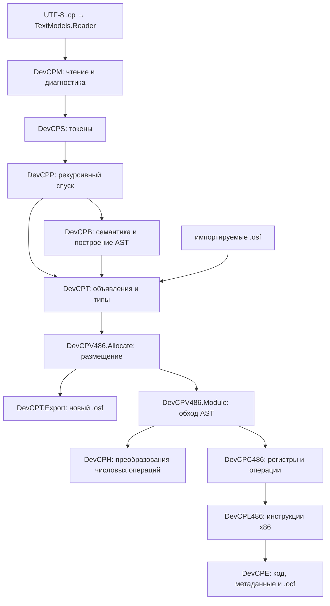

# Внутреннее устройство компилятора Dev

Этот путеводитель описывает исходники bbcb2 в `Dev/Mod`, а не абстрактный OP2. Для команд пользователя сохранён [DevCompiler](Compiler.md); для теоретических оснований — [сопоставление с Crelier](Compiler-Crelier.md). Главная справочная статья — [DevCPT](CPT.md).

## Поток данных



Стрелки показывают поток работы/данных, а не полный граф IMPORT. Все стадии координирует DevCompiler. Во многих модулях состояние глобальное: это последовательная компиляция одного модуля, не независимые объекты compiler session для одновременных вызовов.

## Точный порядок одной компиляции

См. `Module` в [Compiler.cp](../../Mod/Compiler.cp):

1. `DevCPM.Init` подключает Reader и очищает диагностику; устанавливаются языковые опции.
2. `DevCPT.Init` создаёт область текущего модуля. `DevCPB.typSize := DevCPV.TypeSize` подключает вычисление размеров; `DevCPT.processor` получает ID backend.
3. `DevCPP.Module(p)` разбирает текст, читает импорты, строит таблицы и AST. Грамматические процедуры вызывают семантические операции CPB.
4. Если `noerr`: `DevCPV.Init(opt)`, `DevCPV.Allocate`, `DevCPT.Export(ext,new)`.
5. Если `noerr` и включён выпуск object file: `DevCPV.Module(p)`. Для library-интерфейса `libName # ""` выпуск `.ocf` отключается.
6. `DevCPV.Close`; затем регистрация нового `.osf` при `noerr & (new OR ext)`, иначе закрытие временного файла.
7. `DevCPT.Close`, `DevCPM.Close`, снятие ссылки на AST, `Kernel.FastCollect`; вывод диагностических маркеров и статистики.

`.osf` создаётся до кода, но регистрируется после него. Это защищает от публикации нового интерфейса при ошибке генерации. Регистрация `.ocf` находится в `DevCPE.OutCode`. В коде нет общей файловой транзакции для обеих регистраций, поэтому не следует приписывать этой схеме атомарность двух файлов.

## Разделение обязанностей

| Модуль | Что решает | Что читать сначала |
|---|---|---|
| [CPM](CPM.md) | Параметры машины, ввод/вывод, ошибки, CRC | Init, Mark, FPrint, OldSym/NewSym, NewObj |
| [CPS](CPS.md) | Лексика, значения литералов | Get, Identifier, Number, Str |
| [CPT](CPT.md) | Общие графы, области, `.osf`, совместимость | записи, OpenScope, InStruct, FPrintStr, Export |
| [CPP](CPP.md) | Грамматика, объявления, управление построением | Module, Block, Type, ProcedureDeclaration, StatSeq |
| [CPB](CPB.md) | Проверки типов, свёртка констант, нормализация AST | NewLeaf, Op, CheckAssign, Param, Assign |
| [CPH](CPH.md) | Преобразования числовых операций в AST | UseReals, UseCalls |
| [CPV486](CPV486.md) | Размещение и обход дерева | Allocate, Module, expr, stat |
| [CPC486](CPC486.md) | Выбор регистров и последовательностей инструкций | Load, Assert, Assign, Call, Enter/Exit |
| [CPL486](CPL486.md) | Формат operand/label и кодирование x86 | Item, SetLabel, GenMove, GenJump |
| [CPE](CPE.md) | Буфер кода, runtime descriptors, `.ocf` | AllocTypDesc, OutHeader, OutImport, OutCode |

Frontend параметризован машинными константами и callback размера, поэтому «машинно независимый» не означает отсутствия предположений о целевой машине. Здесь указатель и процедурное значение имеют размер 4 байта; backend генерирует i386/x87-код.

## Три результата разбора

- Таблица объявлений отвечает на вопрос «что означает имя?». Она содержит объекты и области.
- Граф типов отвечает на вопрос «каковы тип, размер и совместимость значения?». Он разделяется несколькими объявлениями и может быть циклическим.
- AST отвечает на вопрос «что выполнить?». Декларации доступны из него по ссылкам на объекты; списки операторов и параметров связаны через `link`.

Размещение дополняет существующие записи, а не строит отдельный immutable IR. Поэтому смысл полей `adr`, `ref`, `conval` зависит от стадии. Подробные таблицы — в CPT.

## Пример прохождения программы

```componentpascal
MODULE DemoWalk;
VAR x: INTEGER;
PROCEDURE Inc*;
BEGIN x := x + 1 END Inc;
END DemoWalk.
```

CPS выдаёт токены MODULE/идентификаторы/VAR/PROCEDURE и операции. CPP вводит объект x, объект процедуры и её Head. CPB создаёт Nvar, Nconst, Ndop(plus) и Nassign; процедура и модуль получают Nenter. Глобальная x доступна из тела через внешний Head, а не копируется в область процедуры.

Allocate назначает x смещение и резервирует память процедуры. Export записывает публичную Inc и её сигнатуру, сохраняя скрытой x. CPV проходит тело; CPC превращает обращение к x и сложение в операции над Item, CPL кодирует инструкции, CPE оформляет code/data/fixups и экспорт Inc. Это объясняющая трасса по исходникам, не зафиксированный дизассемблерный результат запуска.

## От `.ocf` к исполняемой программе

Файл `.ocf` содержит машинный код и сведения для runtime/линкера, а не готовый ELF/PE. Существуют разные пути:

- Загрузка модуля средствами системы BlackBox; конечные потребители описаний находятся также вне Dev, в Kernel и загрузчике.
- [DevLinker](Linker.md): существующий монолитный линкер.
- [DevLinker1](Linker1.md): загрузка через [LnkLoad](LnkLoad.md), общая модель [LnkBase](LnkBase.md), запись ELF/PE выбранным writer.
- [DevBootLinker](BootLinker.md): упаковка `.ocf` после готового boot loader.

Не следует смешивать проверки при чтении `.osf`, записи списка использованных объектов и окончательном связывании. Это три места исполнения object model Крелиера.

## Как искать причину ошибки

| Симптом | Начальная точка |
|---|---|
| Неверный токен, число или строка | CPS + CPM.Get |
| Неверный порядок объявлений, forward, WITH | CPP |
| Отвергнуто допустимое выражение/присваивание | CPB и отношения типов CPT |
| Несогласованные импорты, лишнее изменение интерфейса | CPT.InStruct/FPrintStr/Export, CPE.OutImport |
| Неверный размер RECORD/параметров | CPV486.TypeSize/TypeAlloc/Parameters |
| Неверный результат машинной операции | CPV486 → CPC486 → CPL486 |
| Неверная ссылка после загрузки | CPE.OutCode/OutUseBlock → конкретный загрузчик/линкер |
| Ошибка только в подсказках анализатора | DevAnalyzer: собственный разбор, не вызов CPP |

## Проверка будущих изменений

Компилятор запускают из корня проекта:

```bash
printf 'DevCompiler.CompileThis DemoWalk\n' | bbcb2-cli
```

Модуль примера надо предварительно сохранить как `Demo/Mod/Walk.cp`. Для изменения компилятора нужны маленькие программы, проверяющие конкретный случай, и отдельные поставщик/клиент для изменений интерфейса. Успешная компиляция самого компилятора не доказывает корректность сгенерированного кода. Сценарии для CPT перечислены в конце его статьи.

Эта документация подготовлена статическим чтением исходников и книги. При её подготовке исполняемые модули и `.osf`/`.ocf` не пересобирались.
